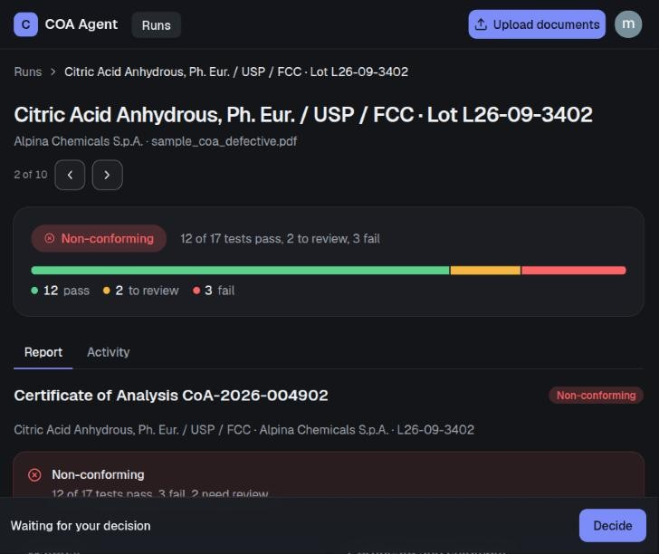
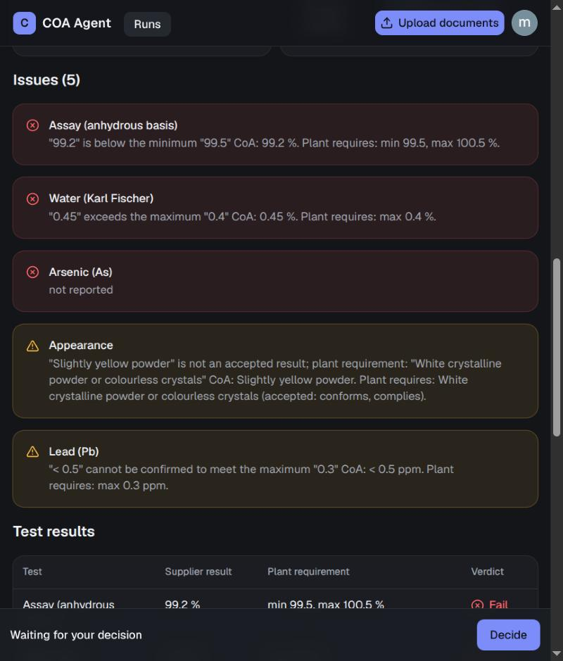
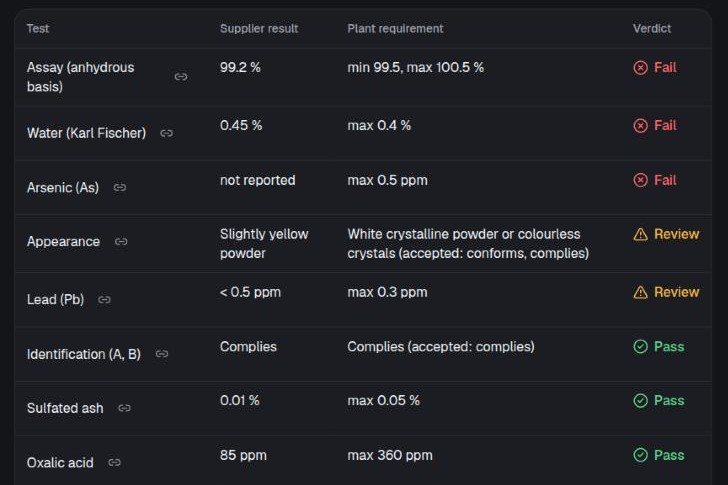

# CoA agent

An agent that reads a **Certificate of Analysis (CoA)** sent by a supplier to a plant, extracts its data,
and checks the reported results against the **plant's own specification** for that material.

## Status

| Part | State |
|---|---|
| PDF text extraction | done |
| Validation that the document is a CoA (LLM), first step after reading the PDF | done |
| Structured extraction of the CoA (LLM) | done |
| Comparison against plant specs (LLM) → `issues` | done |
| Report page: model lays out the results as a json-render UI spec, rendered by the frontend | done |
| Pause / resume (`is_running`, `is_paused`) | state fields only, not wired |
| Plant checks beyond the test table (`approved_suppliers`, `min_remaining_shelf_life_days` in the ERP data) | **not checked**: the data is there, nothing reads it (see [Known limitations](#known-limitations)) |
| Two implementations of the agent, built for development and learning: a fixed graph (`backend/agent/`) and a ReAct agent (`backend/react_agent/`); the API runs the ReAct one | done |
| The agent is a ReAct loop of two nodes, `agent` (the model, with the tools bound) and `tools` (runs what it called); every step of the check is a tool, and the model picks the next one | done |
| Tracing of every run in [LangSmith](https://smith.langchain.com/) | done, opt-in through environment variables only (no code): see [Tracing](#tracing-langsmith) |
| Mail when a lot is non-conforming | done (SMTP, sent by the `notify_quality_team` tool, which refuses any other outcome; a failure is logged as a warning and never fails the job) |
| API: `POST /jobs` queues the agent on an uploaded PDF; `GET /jobs` and `GET /jobs/{id}` return the progress, the UI spec and the tokens and cost (`input_tokens`, `output_tokens`, `cost_usd`) of the run's model calls; `GET /jobs/{id}/pdf` returns the certificate; `POST /jobs/{id}/answer` answers what a paused agent asks (the job is `needs_input` and carries its `question`); `POST /jobs/{id}/decision` records a person's decision | done (jobs are kept in SQLite and survive restarts; CORS allows `http://localhost:3000` unless `CORS_ORIGINS` (comma-separated) says otherwise; every `/jobs` endpoint requires a WorkOS access token, but any signed-in person can see and decide every job, and `by` is the name the frontend sends) |
| Frontend (Next.js + shadcn dashboard) | WorkOS AuthKit sign-in; light, dark or system theme (user menu). `/login` is the front door: a card that continues to WorkOS sign-in, over an animated pharmaceutical line (vials scanned and tagged PASS, REVIEW or FAIL, and drifting molecules; still for reduced motion), and signed-out visitors are sent there with the page they asked for. `/` is an overview: counts that double as filters (all, needs attention, in progress, conforming, awaiting decision), search, and a table you can sort by its headers, with live progress per run, how long each took, and its cost and tokens; the filter and sort are in the address, and `j`/`k`, `/` and `?` work from the keyboard. `/runs/[id]` opens with the lot, the verdict and a bar of the test results, then the report (with an Activity tab of the steps, and links to each finding), a link to open the CoA, and the decision: approve, put on hold or reject, as the signed-in person, with a reason, in a column beside the report (a bottom sheet on a phone); rejecting, holding or overriding the agent asks for confirmation first, and toasts say what was recorded. Upload with the button or by dropping PDFs anywhere; runs come back after a reload |

The plant limits in `backend/docs/erp_demo.json` are **placeholder values**, not real plant data.

## How the agent works

The check was built **twice, for development and learning purposes**, with the same steps and the same prompts and schema:

| | Fixed graph | ReAct agent |
|---|---|---|
| Code | `backend/agent/` | `backend/react_agent/` |
| Who picks the next step | the graph's edges | the model, from each tool's answer |
| Steps are | nodes | tools |
| Run by | `python -m agent.agent` and `scripts/eval_compare.py` | **the API** (`main.py`) |
| Mails a non-conforming lot | no | yes, with the `notify_quality_team` tool |

The API, the job list and everything below the diagram describe the ReAct agent; the fixed graph is kept as the first version and as a
point of comparison. Both are [LangGraph](https://langchain-ai.github.io/langgraph/) graphs and share the Pydantic models in
`backend/schema/schema.py` and the demo ERP. Each has its own copy of the prompts and the state (`prompts.py`, `state.py`), and
`react_agent/tools.py` re-implements the steps instead of calling `agent/agent.py`. Only the ReAct agent uses the `get_material` and `send_email`
tools in `backend/agent/tools.py`; the fixed graph reads the ERP directly.

### The fixed graph (`backend/agent/agent.py`)

```
START → load_document → validate_document ─┬→ get_document_data → load_plant_spec ─┬→ compare_specs → write_summary → render_ui → END
                                           │                                       └──────────────→ write_summary → render_ui → END   (no plant spec)
                                           └─────────────────────────────────────────────────────→ render_ui → END                  (not a CoA)
```

Each node does what the tool of the same name does (table below), in an order the edges fix: the routing is plain Python
(`route_after_validation`, `route_after_plant_spec`), so it never skips or repeats a step. It has no `notify_quality_team`: nothing mails a lot.

### The ReAct agent (`backend/react_agent/react_agent.py`, run by the API)

It has two nodes, `agent` (the model, with the tools bound) and `tools` (a `ToolNode` that runs the calls). The model reads each tool's short
answer and picks the next call, following the order in its system prompt:

```
START → agent ⇄ tools → END        (the agent ends the run when it makes no tool call)

load_document → validate_document ─┬→ get_document_data → load_plant_spec ─┬→ compare_specs → resolve_questions* → write_summary → render_ui → notify_quality_team*
                                   │                                       └──────────────→ write_summary → render_ui → notify_quality_team*   (no plant spec)
                                   └─────────────────────────────────────────────────────→ render_ui                                          (not a CoA)
                                                                                         * only a non-conforming lot is mailed
```

The tools are in `backend/react_agent/tools.py`. Each returns its state update (the document text, the tests and the UI spec stay in the state, not in
the conversation) and a short answer for the model. A tool called too early answers what to call first; any other failure (the ERP down, an invalid
model reply) fails the run. A run is capped at `RECURSION_LIMIT` graph steps (`main.py`); a normal check takes about 18. The price of letting the model
choose: a run takes longer (1.5 to 2.5 minutes on the samples, measured with `gpt-5-mini`) and the model can ignore its prompt, which is why the mail is a guarded tool.

The steps (the fixed graph's nodes, the ReAct agent's tools):

| Step | Uses a model? | What it does |
|---|---|---|
| `load_document` | no | Extracts the text of the PDF at `document_path` with `pypdf`. |
| `validate_document` | yes | Asks the model whether the start of the text is a supplier CoA. If not, or if the PDF has no extractable text, it records a critical `not_a_coa` issue and the model skips to `render_ui`. |
| `get_document_data` | yes | Extracts the CoA into a structured schema: header (certificate, product, lot, dates, PO, quantities), one row per test (specification, method, result, unit, supplier status) and the conclusion. The prompt asks for verbatim values and `null` for anything not stated. |
| `load_plant_spec` | no | Looks up the CoA's `product_code` in the ERP's material master (`docs/erp_demo.json`). If there is no entry, it records a `missing_plant_spec` issue and the model skips `compare_specs`. It runs the `get_material` tool itself. |
| `compare_specs` | yes | Sends the plant requirements and the CoA results (`test`, `result`, `unit` only, so the supplier's own limits and pass/fail can't bias the judgement) to the model with a dedicated prompt. It returns one verdict per plant test: `pass`, `fail` or `review`. |
| `resolve_questions` | yes | ReAct agent only. When the model flags a check as `unsure` (with its reason) in `compare_specs`, whatever its verdict, this tool pauses the run with `interrupt()` for a person to review it and, once answered, judges those tests again with the answer, which it records in `clarifications`. It is its own tool because a resumed run starts the interrupted tool over: the model calls of `compare_specs` must not run twice. `write_summary` refuses to run while a flagged check is unreviewed. The job waits as `needs_input` (the worker is freed) until `POST /jobs/{id}/answer`; the answer survives a restart. |
| `write_summary` | no | Works out the outcome (Conforming, Needs review or Non-conforming) from the issues and the verdicts, and stores the few facts the job list shows in `result`. |
| `render_ui` | yes | Last step. Sends the header, the per-test verdicts and the issues to the model with a prompt that lists the available components (Stack, Grid, Card, Separator, Collapsible, Accordion, Heading, Text, Badge, Alert, Progress, Table) and how to lay out the page. The reply is a [json-render](https://github.com/vercel-labs/json-render) spec stored in `ui_spec`. Invalid JSON is retried once, then replaced by an error Alert. For a document that is not a CoA it skips the model and returns a fixed error Alert. |
| `notify_quality_team` | no | ReAct agent only. Mails the plant's quality team about a non-conforming lot (product, lot, supplier, test counts, a link to the job). It takes no arguments and does nothing for any other outcome: the model, told to mail only non-conforming lots, mailed a conforming one in every live run. |

Rules in the comparison prompt: judge against the plant requirements only; limits are inclusive; a `< x`
result passes a `max` limit only if x ≤ max and can't be confirmed against a `min` limit; a unit mismatch is
`review` (never converted); a qualitative result passes only if it is one of the accepted words; a required
test missing from the CoA is `fail` ("not reported").

### Guardrails around the model call

- **Structured output.** The structured model calls (validation, extraction, comparison) use `with_structured_output` with the Pydantic models in
  `backend/schema/schema.py`.
- **Whitespace and unit cleanup in the schema.** The `Clean` and `Unit` types collapse the line-wrap whitespace
  that PDF extraction leaves behind and turn a unit of `-` into `None`.
- **Coverage check.** The comparison must return exactly one check for each plant test. If it doesn't, the call is
  retried once with the missing/unexpected names listed. Tests that are still missing become `review`, so a gap is
  never read as a pass.
- **Issues are derived in code**, not written by the model: every non-pass verdict becomes an `Issue`
  (`fail` → `non_conforming`/`critical`, `review` → `needs_review`/`warning`).

### State (`backend/agent/state.py`, copied in `backend/react_agent/state.py`)

| Field | Content |
|---|---|
| `document_path`, `document_text` | input PDF and its extracted text |
| `supplier_materials` | CoA header fields |
| `spec_values` | test name → the supplier's printed specification |
| `tests` | structured CoA rows (test, result, unit, specification, method, status) |
| `plant_spec` | the ERP's material record for the CoA's product code: plant requirements, approved suppliers, minimum shelf life |
| `test_checks` | one verdict per plant test, with the supplier result and plant requirement |
| `issues` | non-passing checks and missing-spec problems (see `schema.Issue`) |
| `ui_spec` | json-render spec of the report page |
| `messages` | ReAct agent: the conversation (the task, the model's tool calls and each tool's short answer). Fixed graph: `write_summary` puts the analysis (outcome, counts, header, tests, issues) here as compact JSON and `render_ui` reads it |
| `result` | what the job list shows: outcome, verdict counts, product, lot, supplier (written by `write_summary`, or by `render_ui` for a non-CoA) |
| `cost`, `input_tokens`, `output_tokens` | what the run's model calls used: USD charged by OpenRouter and tokens (output includes reasoning). Every node or tool that calls the model returns its calls' usage (a retry included), and so does the ReAct agent's own `agent` node and the fields add up (`operator.add`), so the checkpoint holds the total of the whole run, restarts included. A call whose provider reports no cost counts 0 |
| `is_running`, `is_paused`, `report` | present but not used yet |

## The report UI (json-render)

The report page is not hand-built for each CoA. The last graph node, `render_ui`, asks the model to **design the page**
as a [json-render](https://github.com/vercel-labs/json-render) spec, and the frontend renders that spec with React.

json-render is a generative-UI framework. Instead of writing HTML or React, the model returns a JSON document that
can only use components from a **catalog**; the frontend maps each catalog component to a React implementation (the
**registry**) and renders it. A spec is a flat map of elements with a root:

```json
{
  "root": "page",
  "elements": {
    "page":  {"type": "Stack", "props": {"direction": "vertical", "gap": "lg", "align": "stretch"},
              "children": ["title", "badge"]},
    "title": {"type": "Heading", "props": {"text": "Citric Acid Anhydrous, Lot L26-09-3402", "level": "h1"}, "children": []},
    "badge": {"type": "Badge", "props": {"text": "Non-conforming", "variant": "destructive"}, "children": []}
  }
}
```

(abridged: a real spec has about 25 elements)

How the pieces fit:

| Step | Where | What happens |
|---|---|---|
| 1. Prompt | `RENDER_UI_PROMPT` in `backend/react_agent/prompts.py` | Lists the available components and their props (the twelve in the table above) and says how to build the page: outcome badge and recommendation, certificate card, findings as Alerts (critical first), the results table, and a "not assessed" note. The model gets only the header, the per-test verdicts and the issues, and must copy values exactly. |
| 2. Tool | `render_ui` in `backend/react_agent/tools.py` | Sends the prompt, parses the JSON reply (fenced or not) and stores it as `ui_spec`. Invalid replies are retried once with the error, then replaced by an error Alert. |
| 3. API | `POST /jobs` in `backend/main.py` | Queues the agent for an uploaded PDF; a worker runs it, records what each tool is doing, then the `ui_spec`. |
| 4. Upload | `frontend/components/upload-button.tsx`, `report-context.tsx` | The **Upload documents** button (or a drop anywhere on the page) posts each PDF to the API, which queues them, and polls the jobs once a second while any is unfinished. There is one run per file (queued, loading, error, done). |
| 5. Render | `frontend/components/report-renderer.tsx` | Validates the spec against the catalog (the same twelve components, taken from `@json-render/shadcn`) and renders it inside the page's `<main>`. An invalid spec shows an error message instead of rendering. |

The renderer (json-render, the shadcn components and zod) is loaded on demand with `next/dynamic` and preloaded when an
upload starts, so the idle page does not download it.

### What it looks like

The run page for `backend/docs/sample_coa_defective.pdf`. Above the tabs, the lot, the verdict and a bar of the test results are
part of the page; the **Report** tab below is the json-render spec: the certificate title, an outcome Alert and the certificate
details. The release decision always stays with QA (the **Decide** bar at the bottom).



The findings (critical in red, warnings in yellow), one Alert per non-passing check.



The results table with one verdict per plant test.



To generate it yourself, start the backend and the frontend (see [Running it](#running-it)), click **Upload documents**
and pick a CoA PDF. The report appears after about a minute.

## Repository layout

```
docs/images/        screenshots used in this README
backend/
  react_agent/      the ReAct agent main.py runs (the second implementation): the agent (react_agent.py), the steps of the check as tools (tools.py), its prompts (prompts.py) and state (state.py)
  agent/            the fixed graph, the first implementation (agent.py, prompts.py, state.py), and the get_material and send_email tools (tools.py) that the ReAct agent's tools use
  schema/           Pydantic models: CoA extraction, check verdicts, issues (schema.py)
  erp.py            the demo ERP: the material master, read from docs/erp_demo.json
  docs/             sample CoAs and the demo ERP data
    sample_coa_citric_acid.pdf    conforming CoA (should produce no issues)
    sample_coa_citric_acid_3pages.pdf  the same kind of conforming CoA over three pages, for bigger documents
    sample_coa_defective.pdf      CoA with five seeded defects
    erp_demo.json                 materials with their plant requirements
  scripts/eval_compare.py         end-to-end check against the real model (runs the fixed graph)
  tests/                          unit tests (mocked model): API and queue, sign-in, comparison, validation, mail
  main.py                         FastAPI app: /health, the /jobs endpoints (create, list, get, pdf, decision), plus the job queue and its workers
  auth.py                         checks the WorkOS access token on every /jobs request
  notify.py                       the mail about a non-conforming lot (SMTP): its text, and the sending the notify_quality_team and send_email tools do
  jobs.py                         the jobs table (SQLite, with the decisions) and the uploaded PDFs; data lives in backend/data/ (gitignored)
frontend/           Next.js + shadcn dashboard, light / dark / system theme (tokens in app/globals.css, contrast checked by lib/contrast.test.ts)
  proxy.ts                         signs people in with WorkOS AuthKit; signed-out visitors go to /login
  app/(auth)/login/page.tsx        the login page; app/auth/ and app/sign-in/ hold the sign-in, callback, sign-out and token actions
  app/(app)/page.tsx               the overview; app/(app)/runs/[id]/page.tsx is the report page
  components/upload-button.tsx     picks one or more PDFs and sends them to the API
  components/report-context.tsx    the list of runs (queued / loading / error / done), the jobs polled from the API, and the POST /jobs calls
  components/overview.tsx          filter tiles, search and sort, the list of rows, empty / offline states, j / k keys
  components/run-row.tsx           one row: status, product and lot, verdict counts or progress, time
  components/run-page.tsx          the report page: header, previous / next run, Report and Activity tabs
  components/answer-panel.tsx      the checks a paused agent flagged as unsure (a run that needs your review), and the form that answers them
  components/account-context.tsx   who is signed in (name, email), for the forms
  components/acting-as.tsx         "Deciding as ..." / "Answering as ...": the signed-in person, shown and not chosen
  components/decision-panel.tsx    approve / hold / reject a finished run, as the signed-in person, with a reason
  components/page-dropzone.tsx     drop PDFs anywhere; components/live-announcer.tsx tells screen readers when a run ends
  lib/runs.ts                      filter, search, priority sort and tallies of the runs
  lib/access-token.ts              the session's access token for the API, cached until shortly before it expires
  components/report-renderer.tsx   json-render catalog + registry (shadcn components)
```

### The demo ERP (`docs/erp_demo.json`)

`erp.py` reads this file; connecting a real ERP means rewriting its one function (`get_material`).

`materials` maps product codes to the plant's requirements. Test names must match the CoA's names exactly.

- numeric test: `{"test": "Water (Karl Fischer)", "type": "numeric", "max": 0.4, "unit": "%"}` (`min` and/or `max`)
- qualitative test: `{"test": "Appearance", "type": "qualitative", "accepted": ["conforms", "complies"], "requirement": "..."}`

Only `tests` is used. A material also carries `specification_ref`, `approved_suppliers` and `min_remaining_shelf_life_days`,
which are **not checked yet**: changing them has no effect on a verdict, and a CoA from a supplier that is not approved, or
with too little shelf life left, is not flagged.

## Running it

Backend (Python 3.10+, developed on 3.14, with a virtualenv in `backend/.venv`):

```bash
cd backend
uv venv .venv   # first time only
uv pip install --python .venv/bin/python -r requirements-dev.txt
```

The model is reached through [OpenRouter](https://openrouter.ai/) (`openai/gpt-5-mini`). Put your key in
`backend/.env` (gitignored; loaded automatically with `python-dotenv`):

```
OPENROUTER_API_KEY=your-openrouter-api-key-here
WORKOS_CLIENT_ID=client_...   # the same client id as the frontend's; the API only accepts tokens signed for it
```

The API needs a signed-in person for everything under `/jobs`: the frontend sends the WorkOS access token as
`Authorization: Bearer ...` and the API checks it against WorkOS's public keys. Without `WORKOS_CLIENT_ID` it answers 503
instead of running open. `/health` needs no token, so `curl` the jobs endpoints below with a token from a signed-in session.

Each job records who uploaded it (`owner`, their sign-in id).

When an analysis finds a lot **non-conforming**, the API can mail
its summary (product, lot, supplier, test counts and a link to the job). Any SMTP provider works; add the settings to
`backend/.env`. Without `SMTP_HOST` and `NOTIFY_EMAIL` no mail is sent. `.env` is loaded when the API starts, so **restart the
API after changing it** (`fastapi dev` reloads on code changes, not on `.env`).

#### With Resend

[Resend](https://resend.com) needs no IP allow-list. In its dashboard, create an API key (*API Keys*, sending access):

```
SMTP_HOST=smtp.resend.com
SMTP_PORT=587                         # STARTTLS; the code does not speak port 465 (implicit TLS)
SMTP_USER=resend                      # always the word "resend"
SMTP_PASSWORD=re_...                  # the API key
SMTP_FROM=onboarding@resend.dev       # required: the login is not an address (see below for your own sender)
NOTIFY_EMAIL=you@example.com          # who gets the mails
APP_URL=http://localhost:3000         # optional: where the frontend is served; the mails then link to the job's page
```

`onboarding@resend.dev` is Resend's test sender: it only delivers to the address you signed up to Resend with. To send from your
own address and to anyone, verify a domain (*Domains → Add Domain*, then add the SPF and DKIM records it shows at your DNS
provider; a subdomain such as `alerts.example.com` keeps its reputation apart from your main mail) and change the sender:

```
SMTP_FROM=CoA Agent <coa-alerts@alerts.example.com>
```

#### With Gmail

```
SMTP_HOST=smtp.gmail.com
SMTP_PORT=587                  # default 587; STARTTLS is used when SMTP_USER is set
SMTP_USER=you@gmail.com        # the login; also the "From" address unless SMTP_FROM is set
SMTP_PASSWORD=...              # an App Password (needs 2-Step Verification), not your account password
NOTIFY_EMAIL=you@example.com
```

#### Other providers

Set `SMTP_HOST`, `SMTP_USER` and `SMTP_PASSWORD` to what the provider gives you for SMTP, and `SMTP_FROM` to a sender it has
verified whenever the login is not itself an address (Brevo's is not, for example). Leave `SMTP_USER` out to send without
encryption or login, e.g. to a local mail catcher on `127.0.0.1:1025`.

A mail that cannot be sent never fails the job: it stays done, the worker keeps running, and the API logs one warning:

```
WARNING agent.agent: the non-conforming mail was not sent: SMTPAuthenticationError: (525, b'5.7.1 Unauthorized IP address')
```

That example is Brevo refusing a login from an IP that is not on its allow-list (*Security → Authorized IPs*); a server needs
its own address added there. With Resend, the usual causes are a wrong API key (the login fails), a sender on a domain that is
not verified, or, from `onboarding@resend.dev`, a recipient other than your own address (the send is refused). To check the
settings without running the agent, connect, `starttls()`, `login()` and send one message with `smtplib` using the values from
`.env`.

If the mail comes from the wrong provider, the API is still running with the settings it had when it started: restart it.

Every setting, for reference (the backend reads the environment and `backend/.env`; the frontend reads `frontend/.env.local`):

| Variable | Where | Meaning |
|---|---|---|
| `OPENROUTER_API_KEY` | backend | required: the model is reached through OpenRouter |
| `WORKOS_CLIENT_ID` | backend, frontend | required: the same value in both; without it the API answers 503 |
| `MAX_CONCURRENT_RUNS` | backend | worker threads, default 2 |
| `JOBS_DIR` | backend | where `jobs.db`, `checkpoints.db` and `uploads/` live, default `backend/data/` |
| `CORS_ORIGINS` | backend | allowed browser origins, comma-separated, default `http://localhost:3000` |
| `LANGSMITH_TRACING`, `LANGSMITH_API_KEY`, `LANGSMITH_ENDPOINT`, `LANGSMITH_AGENT_ID`, `LANGSMITH_AGENT_ENVIRONMENT` | backend | optional: send a trace of every run to LangSmith, see [Tracing](#tracing-langsmith) |
| `SMTP_HOST`, `SMTP_PORT`, `SMTP_USER`, `SMTP_PASSWORD`, `SMTP_FROM`, `NOTIFY_EMAIL`, `APP_URL` | backend | the non-conforming mail, see above |
| `WORKOS_API_KEY`, `WORKOS_COOKIE_PASSWORD`, `NEXT_PUBLIC_WORKOS_REDIRECT_URI` | frontend | WorkOS AuthKit (the cookie password is 32+ characters) |
| `NEXT_PUBLIC_API_URL` | frontend | the API's address, default `http://localhost:8000` |

### Tracing (LangSmith)

Every run can be traced in [LangSmith](https://smith.langchain.com/): each graph step, each model call (prompt, reply, tokens, latency) and
each tool call, so you can see why the ReAct agent picked a tool, or what a prompt really sent. There is no tracing code: LangChain and LangGraph
read these variables, and the `langsmith` client comes in with `langchain-core`. Add them to `backend/.env`:

```
LANGSMITH_TRACING=true
LANGSMITH_API_KEY=lsv2_...                              # a LangSmith API key
LANGSMITH_ENDPOINT=https://eu.api.smith.langchain.com   # EU region; leave out for the US default
LANGSMITH_AGENT_ID=...                                  # the agent id from your LangSmith workspace
LANGSMITH_AGENT_ENVIRONMENT=local                       # labels where the traces come from (local, staging, ...)
```

- It is **off** unless `LANGSMITH_TRACING=true`; without the variables the app runs as before and sends nothing. `.env` is loaded when the
  API starts (and by `python -m agent.agent`), so restart after changing it.
- It applies to both implementations, the API's ReAct runs and the fixed graph's command-line runs.
- A job's id is its LangGraph `thread_id`, which LangGraph adds to a run's metadata, so look for a job's trace by that id.
- Traces hold the CoA text and the model's replies. Turn tracing off, or use a workspace the data may go to, when the certificates are confidential.

Run the fixed graph on the sample CoA, or on another PDF (the ReAct agent runs through the API):

```bash
cd backend
.venv/bin/python -m agent.agent                              # docs/sample_coa_citric_acid.pdf
.venv/bin/python -m agent.agent docs/sample_coa_defective.pdf
.venv/bin/python -m agent.agent path/to/other.pdf
```

It prints the extracted header, each test with its result and the supplier's specification, the verdict for
every plant test, and the list of issues. On the defective sample the issues are:

| Test | Seeded defect | Expected |
|---|---|---|
| Water (Karl Fischer) | 0.45 %: passes the supplier's 0.5 limit, not the plant's 0.4 | critical |
| Assay (anhydrous basis) | 99.2 %: below min 99.5 | critical |
| Arsenic (As) | row removed from the CoA | critical |
| Lead (Pb) | `< 0.5`: can't be confirmed against max 0.3 | warning |
| Appearance | "Slightly yellow powder": not an accepted result | warning |

Backend API (`GET /health`, `POST /jobs`, `GET /jobs`, `GET /jobs/{id}`):

```bash
cd backend && .venv/bin/uvicorn main:app --reload
```

`POST /jobs` takes a PDF as multipart form data (field `file`), stores it and answers `202` with the new job. A run
takes a minute or more, because the agent makes several model calls, so the work happens in the background: the
client polls `GET /jobs` (every job, oldest first, without the report) or `GET /jobs/{id}` (one job, with the report).
A job looks like this:

| Field | Meaning |
|---|---|
| `id` | the job id, which is also the agent's LangGraph `thread_id` |
| `status` | `queued` (waiting for a worker), `running`, `done` or `error` |
| `statuses` | what the nodes reported, in order. Each node calls `_status(...)` first thing, which writes `{"status": ...}` with LangGraph's `get_stream_writer()`; the worker streams the graph in the `custom` stream mode and appends each one |
| `ui_spec` | the report, in `GET /jobs/{id}` only, once the job is `done`. The worker reads it from the run's checkpoint once the graph has finished, so only the report is copied into the job |
| `error` | why the job failed, when `status` is `error` |
| `started_at` | when a worker took the job, in milliseconds since the epoch |
| `finished_at` | when the job ended (done or error), in milliseconds since the epoch |
| `input_tokens`, `output_tokens`, `cost_usd` | what the run's model calls used (output tokens include reasoning) and what OpenRouter charged, in US dollars. Written when the job ends, from the totals in the run's state, so a failed job keeps what its calls before the failure cost; `null` for jobs from before this was recorded, and for a run that failed before its first call |
| `decision`, `decided_by`, `decided_at`, `reason` | a person's decision on the finished job (see below); all `null` until someone decides |
| `has_pdf` | whether the uploaded certificate is still stored, so `GET /jobs/{id}/pdf` has it (jobs from before the PDFs were kept do not) |
| `result` | what the job list shows without the report, once the job is done: `outcome` (Conforming, Needs review, Non-conforming or Not a CoA), `counts` of pass / fail / review, `product`, `lot`, `supplier`. Written by `write_summary`, or by `render_ui` for a document that is not a CoA |

How the queue works:

- `MAX_CONCURRENT_RUNS` (default 2) worker threads take job ids from an in-memory queue. The jobs themselves are rows in
  `backend/data/jobs.db`, and the uploaded PDFs are kept in `backend/data/uploads/` (set `JOBS_DIR` to move both): the certificate is the record a decision is about.
- The agent is compiled with a SQLite checkpointer (`backend/data/checkpoints.db`) and run with the job id as its
  `thread_id`, so its state is saved after every step.
- When the API starts, jobs that were running (the process died) go back to the queue. A job whose run had passed some
  steps continues after the last finished one; one that had not starts over. Jobs are kept until you delete `backend/data/`.
- The queue is per process: run one uvicorn worker.

The frontend shows the `statuses` in order and knows nothing about the graph. Tools the model does not call
(for example everything between `validate_document` and `render_ui` for a document that is not a CoA) send no status,
so they do not appear. `get_stream_writer()` only works inside a graph run, so the unit tests make it a no-op
(`tests/conftest.py`).

```bash
curl -F "file=@docs/sample_coa_defective.pdf" localhost:8000/jobs   # prints the job, including its id
curl localhost:8000/jobs/<id>
```

### Decisions

The agent only prepares the report; a person decides. `POST /jobs/{id}/decision` takes JSON
`{"decision": "approved" | "rejected" | "on_hold", "by": "...", "reason": "..."}` and answers with the job.

- A `reason` is required to reject or hold, and to approve a lot the agent did not find conforming (an override).
- `approved` and `rejected` are final (`409` afterwards); a lot `on_hold` can be decided again, and the new decision replaces the hold.
- Only a finished job can be decided (`409` before). The caller must be signed in, and the frontend sends the signed-in person's name as `by`, but the API does not check it: `by` is whatever the caller says, not tied to the signed-in id, so there is no e-signature and no audit trail, and a later decision replaces an earlier hold.

Frontend:

```bash
cd frontend && npm install && npm run dev
```

Sign in with WorkOS first: the frontend needs the `frontend/.env.local` variables above. Start the backend (see above) and the frontend, then click **Upload documents** and pick a CoA PDF
(for example `backend/docs/sample_coa_defective.pdf`). The report appears in the page after about a minute. The
frontend calls `http://localhost:8000`; set `NEXT_PUBLIC_API_URL` to use another address.

The component list in `RENDER_UI_PROMPT` (`backend/react_agent/prompts.py`, copied in `backend/agent/prompts.py`) and the catalog in
`frontend/components/report-renderer.tsx` must be kept in sync by hand.

## Testing

```bash
cd backend
.venv/bin/python -m pytest -q           # unit tests, mocked model, no API key needed
.venv/bin/python -m scripts.eval_compare   # calls the real model on both sample CoAs, diffs the verdicts
```

The unit tests cover issue derivation, the retry and the fallback to `review`, the missing-spec routing, the job queue and
restart behaviour, decisions, sign-in, and the mail (including the warning when it cannot be sent). The frontend has Vitest
tests for the components and helpers.
The eval script is slower (several model calls) and needs `OPENROUTER_API_KEY`. It exits non-zero if any
verdict differs from the expected one. It covers the one-page conforming sample and the defective one, not the three-page sample.

## Continuous integration

GitHub Actions run on every pull request and on pushes to `main` (`.github/workflows/`). Each workflow only runs when
its own folder changes. The same steps run locally:

| | Backend (`backend/`, Python 3.14) | Frontend (`frontend/`, Node 24) |
|---|---|---|
| Format | `.venv/bin/ruff format .` | `npm run format` |
| Lint | `.venv/bin/ruff check .` | `npm run lint` (Biome) |
| Build | `python -m compileall -q . && python -c "import main"` | `npm run build` (also type-checks) |
| Test | `.venv/bin/python -m pytest -q` | `npm test` (Vitest) |

## Known limitations

- `pypdf` only reads text-based PDFs; scanned CoAs would need OCR.
- The model's output casing varies between runs (for example the supplier name is sometimes printed in capitals);
  values are copied from the document, not normalised.
- Numeric comparison is done by the model. The retry and the eval script exist to guard it; doing the numeric
  tests in Python and sending only qualitative rows to the model is a possible next step.
- Test names on the CoA must match the plant specification exactly; there is no fuzzy matching yet.
- The ERP's `approved_suppliers` and `min_remaining_shelf_life_days` are never read, so an unapproved supplier or a lot with
  too little shelf life left still comes out as conforming. Only the test table is compared.
- Everything signed in sees everything: each job records its `owner`, but the API does not filter or check it, so any
  signed-in person can list every job, open its PDF and decide it. `by` on a decision and an answer is free text: the frontend fills it with the signed-in person's name, but the API does not check it.
- An upload is not checked: no size limit, and no check that it is a PDF before a worker picks it up (a non-PDF becomes a failed job).
- The queue is in memory and per process, and the API must run as one uvicorn worker. Jobs and uploads live in
  `backend/data/` with no cleanup.
- With LangSmith tracing on, the CoA text and the model's replies leave the machine for LangSmith, and nothing marks which traces belong to a
  job beyond its `thread_id`; the job and the UI do not link to them.
- A failed mail is only a log line; nothing on the job or in the UI says that the notification was not sent.
- Backend dependencies in `requirements.txt` are not pinned (only `PyJWT` has a floor), so installs are not reproducible.
- `npm audit --omit=dev` reports 7 high-severity findings, all through `shadcn` (a CLI that is listed as a runtime
  dependency, via `fast-glob` / `micromatch` / `braces`), not through code the app runs.
- The report UI is written by the model, so values in it are retyped by the model. The verdicts and issues stay in state
  from `compare_specs`; the page is a display layer. The frontend validates the spec against its catalog before rendering.
